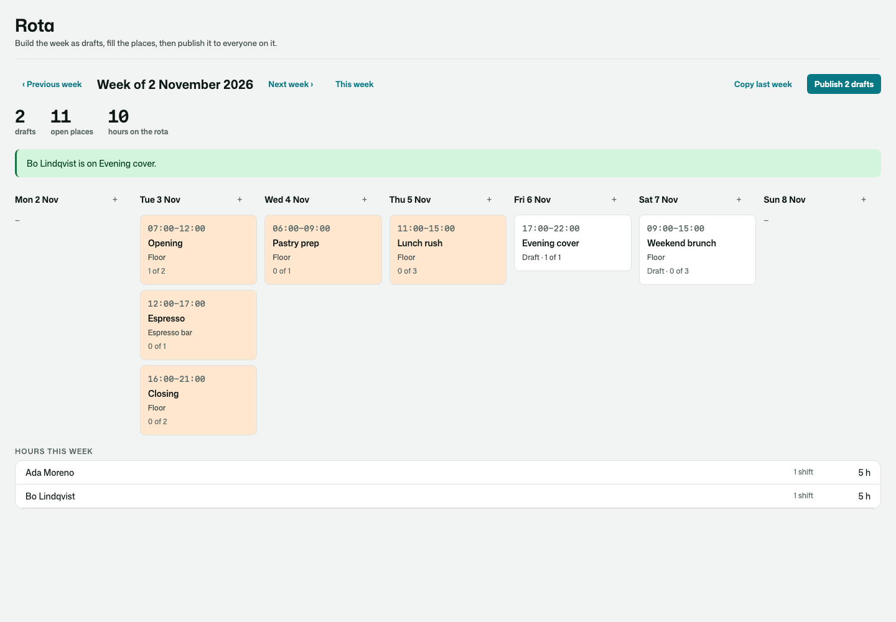
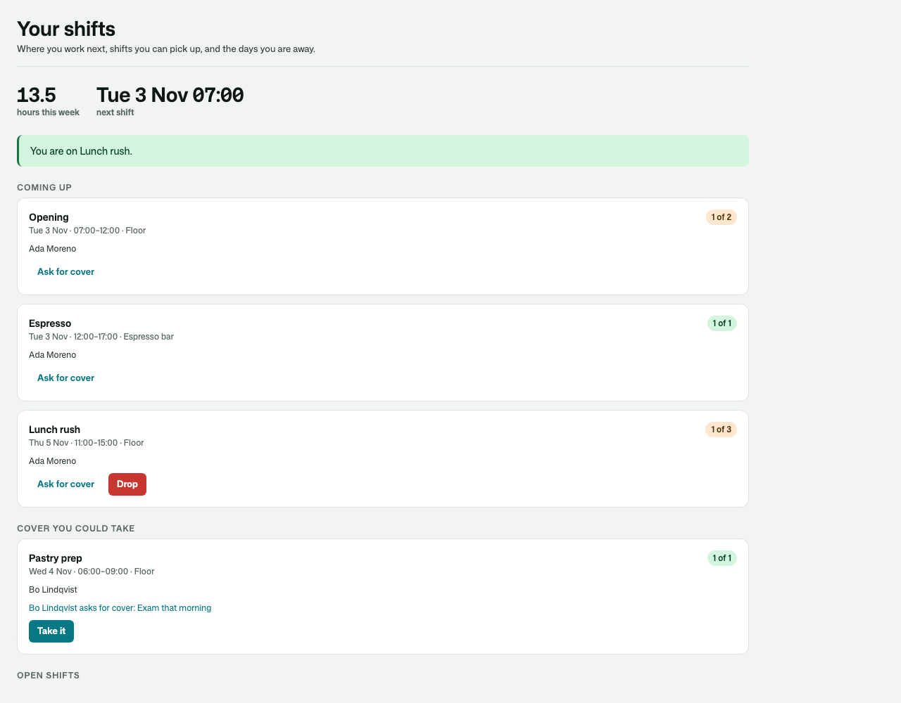
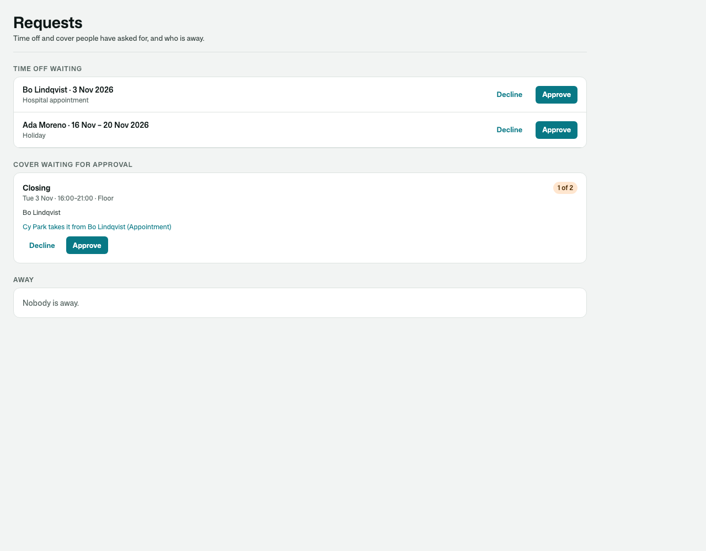
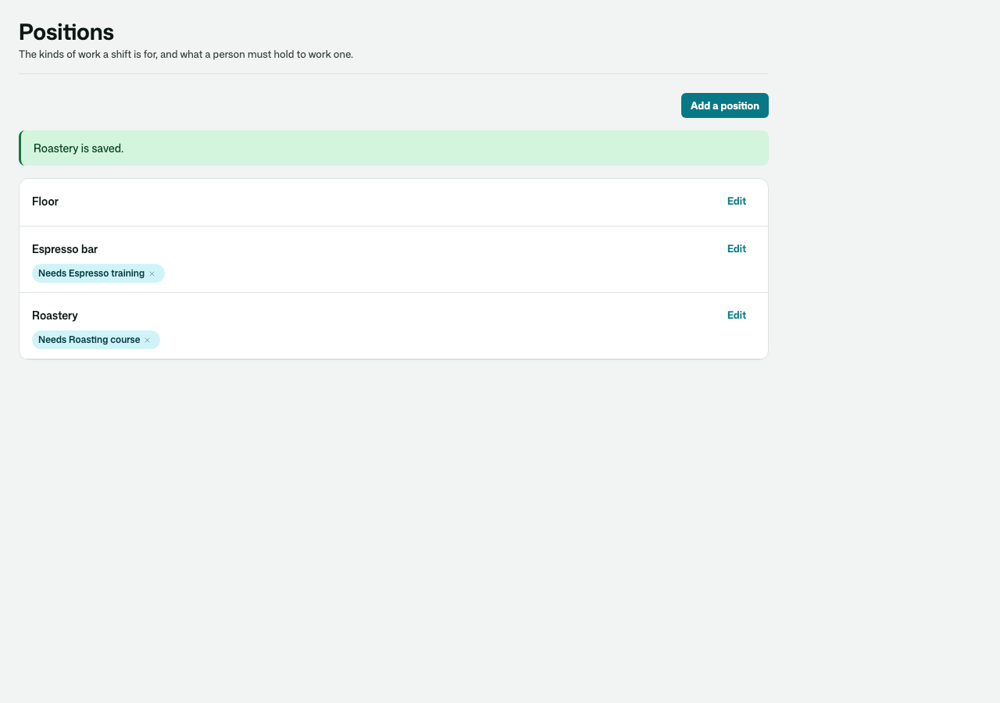
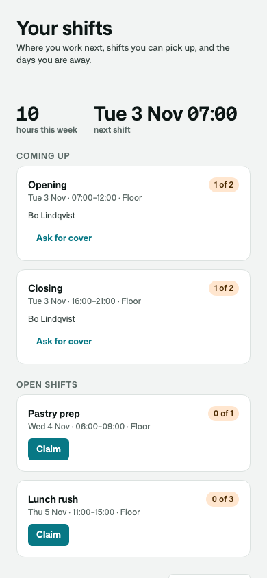
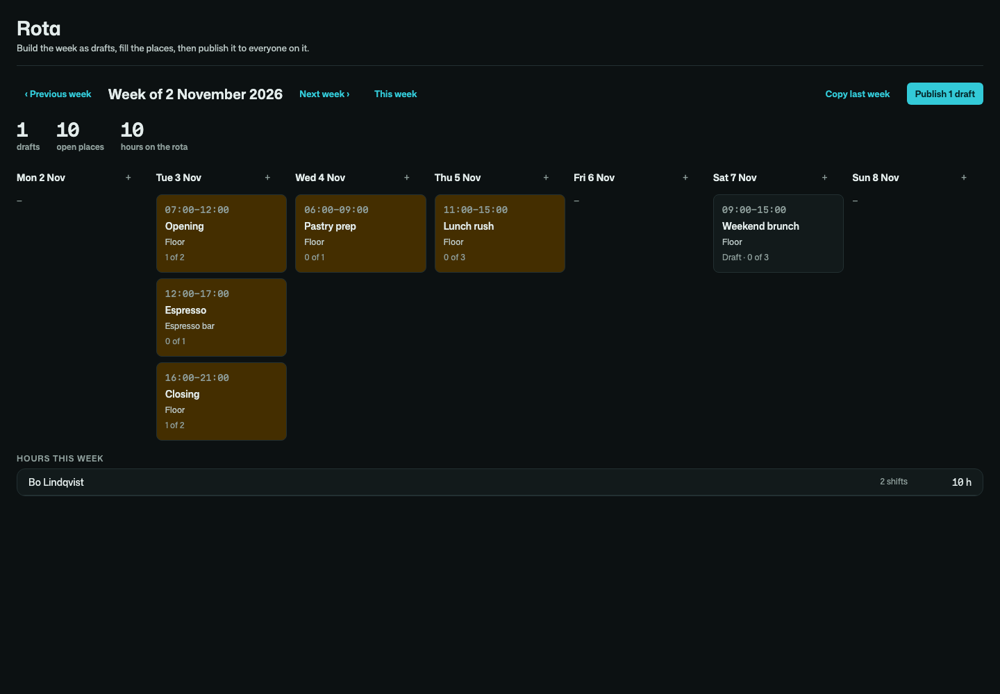

# Osysharp.ShiftScheduling

**A staff rota.** Who works when — for a café, a clinic, a shop floor, a venue, a warehouse, a volunteer team.

- **Shifts** with a number of places, a position ("Front desk", "Kitchen"), a break and a place — built as **drafts** and
  **published** in one go, so people hear about their week once.
- **Places** a manager assigns or a worker **claims** from the open shifts — never over-filled, one place a person, no
  overlaps — and every refusal a sentence: *You are on Closing then.* · *Bo is off on 3 Nov.* · *Espresso bar needs
  Espresso training: no record of the course.*
- **What a position requires** ("food-hygiene", "forklift"), answered by your app — or by
  [Osysharp.Qualifications](https://github.com/osysharp), which arrives with `Osysharp.ShiftScheduling.Qualifications` by itself.
- **Your own rules** (`IShiftRule`), found without wiring: *Trainees never work a shift alone.*
- **Time off** asked for and approved (the manager is told which shifts it touches), and the **hours each week someone is
  never free** — a claim is refused then; a manager is asked to confirm.
- **An hours cap** per week, as a warning a manager can go past knowingly.
- **Cover and swaps**: ask anybody, ask one colleague, or offer a swap for their shift — taken, then approved (or not);
  dropping a shift far enough ahead where you allow it.
- **Hours** per person and period, less breaks; **copy last week**; **cancel** a shift and keep who was on it.
- **A reminder before every shift**, durable: it waits while the shift is a draft, re-sets when it moves, and stops when
  the place is given up.

| A manager's week | A worker's shifts |
|---|---|
|  |  |

| Requests | Positions |
|---|---|
|  |  |

| On a phone · in the dark |
|---|
|   |

## Use it

```osy
// app.osy
use Osysharp.Identity@0;
use Osysharp.ShiftScheduling@0;
```

```osy
using Osysharp.Identity;
using Osysharp.ShiftScheduling;

policy ManagesShifts => IsManager;    // builds and publishes the week, assigns, approves time off and cover
policy WorksShifts => IsStaff;      // sees the published rota, claims open places, asks for time off and cover

app.ShiftScheduling = new ShiftSchedulingSetup { TimeZone = "Europe/London", ReminderLead = TimeSpan.FromHours(12), MaxHoursPerWeek = 40m,
                           WorkersMayDrop = true, CoverNeedsApproval = true };

// The app's own rule — found, never wired.
public class NoDoubleCloses : IShiftRule {
  public string? Refusal(Shift shift, Principal worker) { … return null; }
}

// Telling people: the kit decides when, the app decides how.
[On] void Remind(ShiftReminderDue e) { /* send e.Assignment.Worker a message */ }
[On] void Published(ShiftsPublished e) { /* tell each of e.Workers their week is out */ }
```

From code: `AddShift`, `UpdateShift`, `PublishShifts(from, to)`, `CancelShift`, `CopyWeek`, `AssignShift(shift, worker)`,
`ClaimShift(shift)`, `WhyNotOnShift(shift, worker)`, `Unassign`, `DropShift`, `RequestCover`, `RequestSwap`,
`AcceptCover`, `DecideCover`, `RequestTimeOff`, `DecideTimeOff`, `MarkUnavailable`, `HoursBetween(from, to)`,
`ShiftsOf(worker)`, `OpenShiftsFor(worker)`. Events: `ShiftsPublished`, `ShiftAssigned`, `ShiftUnassigned`,
`ShiftChanged`, `ShiftCancelled`, `ShiftReminderDue`, `CoverRequested`, `CoverTaken`, `ShiftCovered`, `CoverDeclined`,
`TimeOffRequested`, `TimeOffDecided`. Give staff their roles with Osysharp.UserManagement.

## Pages

`/shifts` (the signed-in person), `/staff/rota` (the week), `/staff/rota/requests` and `/staff/rota/positions` are served
in the app's working shell, in its theme. Take one over by declaring a component of the same name, or place `MyShifts`,
`RotaWeek`, `RotaRequests`, `RotaPositions` or `ShiftCardView` on a page of your own.

## Personal data

Why somebody asked for time off or cover is classified personal content. In an app with Osysharp.Privacy,
Osysharp.Privacy.ShiftScheduling arrives by itself: a person's shifts, time off, unavailability and cover requests are in their
copy of their data and are erased when they ask.

## What informed it

- **Deputy** — open shifts the first eligible person claims; swaps that exchange a shift for a colleague's future one,
  only between people with the training it needs, with manager approval optional; unavailability and leave beside the
  schedule; changes reaching staff only when published.
- **When I Work** — dropping a shift versus swapping it versus releasing it; drops that wait for approval; a notice
  period before a drop.
- **RosterElf and Dolce** — a warning about the hours a change adds before a manager approves it.
- **Rotacloud, Planday and Sling** — a week built as a draft and published at once, copied forward, with hours per person
  for payroll.

## Source

[github.com/osysharp/shiftscheduling](https://github.com/osysharp/shiftscheduling). Its tests (`tests/`) are a café's: every
behaviour above, each seam shown, and the pages under `osy test --pixels`.
